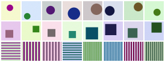
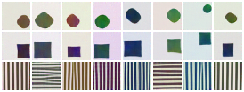

# edm-cond

**Class-conditional, pixel-space diffusion models trained from scratch on your own labelled images.**

A fork of NVIDIA's [EDM](https://github.com/NVlabs/edm) (Karras et al. 2022, *Elucidating the Design Space of Diffusion-Based Generative Models*) adapted for internal datasets that look nothing like ImageNet: **no autoencoder, no latent space, no pretrained component anywhere** in training or sampling.

<p align="center">
  &nbsp;&nbsp;
  <br>
  <sub>Left: real images, one row per class. Right: samples at guidance 2 from a tiny model trained for 20 minutes on CPU (<a href="docs/smoke-test/README.md">smoke test</a>).</sub>
</p>

## Features

- **Your data as it is**: a CSV with relative image paths and **string labels**, plus an image root. A validation and pre-resizing tool is included.
- **Classifier-free guidance** with a learned NULL token, guidance interval, per-class generation by label name.
- **Configurable resolution**: a 64×64 preset, and a native 224×224 preset in the Simple-Diffusion style (pixel patching, attention only at low resolution, noise shift, gradient checkpointing).
- **Sim-to-real style transfer**: SDEdit / ILVR translation of simulated images with a trained model (unconditional by default), plus a domain-gap diagnostic (spectrum, grain, sharpness, denoising profile).
- **Modular conditioning**: conditions are a dict of encoders, so further categorical or scalar attributes are small additions.
- **Monitoring without pretrained metrics**: fixed-σ validation loss, per-σ training loss, fixed-seed sample grids, pixel-space memorization check.
- **Sized for one RTX 3090 (24 GB)**: bf16 autocast, TF32, gradient accumulation, multiple EMAs, exact resume, graceful Ctrl-C.
- Runs on **CPU** (slowly) for tests, with a 45-test CPU suite that runs in about 35 s.

## Quick start

```bash
# 1. Install (uv; pick the cu126 or cpu extra)
uv sync --extra cu126

# 2. Validate + pre-resize the data
uv run python tools/prepare_dataset.py --csv /data/train.csv --image-root /data/images \
    --path-col path --label-col label --resolution 64 --out /data/prepared-64.zip

# 3. Measure speed and memory (2-3 ticks), then set --batch-gpu and --duration
uv run python train.py --config configs/64px_3090.yaml --data /data/prepared-64.zip --outdir runs-probe \
    --tick 5 --duration 0.015 --snap 1000 --dump 1000 --sample-every 0 --val-every 0

# 4. Train (Ctrl-C stops cleanly; add --resume runs/<run>/training-state-XXXXXX.pt to continue)
uv run python train.py --config configs/64px_3090.yaml --data /data/prepared-64.zip --outdir runs --duration 44

# 5. Watch runs/<run>/samples-*.png and the curves
uv run python tools/plot_stats.py runs/<run>

# 6. Sample: 16 images per class at guidance 2, with a grid
uv run python generate.py --network runs/<run>/network-snapshot-XXXXXX.pkl --outdir out --per-class 16 --guidance 2 --grid 1
```

## Documentation

| | |
|---|---|
| [Installation](docs/installation.md) | uv, CUDA check, tests |
| [Data](docs/data.md) | CSV format, labels, split, `prepare_dataset.py`, cache, augmentation |
| [Training](docs/training.md) | presets, sizing a run, all knobs, resume |
| [Monitoring](docs/monitoring.md) | run directory, validation loss, per-σ curves, grids, memorization |
| [Sampling](docs/sampling.md) | classes, CFG, guidance interval, outputs, Python API |
| [Going to 224 px](docs/224px.md) | patching, attention placement, noise shift, checkpointing |
| [Sim-to-real style transfer](docs/style-transfer.md) | SDEdit / ILVR, choosing σ₀, measuring the gap |
| [Conditioning & extensions](docs/conditioning.md) | NULL token, adding new conditions |
| [How it works](docs/how-it-works.md) | EDM maths, code map, file formats, differences from EDM |
| [Troubleshooting](docs/troubleshooting.md) | common errors and fixes |
| [CLI reference](docs/cli-reference.md) | every option, generated from the code |

## Repository layout

```
train.py                    training CLI (YAML presets + overrides)
generate.py                 sampling CLI (CFG, class names, grids, metadata.csv)
configs/                    64px_3090.yaml, 224px_3090.yaml
training/
  dataset.py                CSVImageDataset: raw CSV or prepared zip/dir
  conditioning.py           ConditionEncoder / ClassEmbedding / ConditionStack
  networks.py               SongUNet, DhariwalUNet, EDMPrecond
  loss.py                   EDMLoss, noise shift, σ bins
  sampling.py               Heun sampler with CFG, grids
  training_loop.py          the training loop
  augment.py                EDM's non-leaking augmentation (unchanged)
tools/
  prepare_dataset.py        validate + resize + pack
  make_synthetic_dataset.py tiny test dataset in the same format
  plot_stats.py             curves from stats.jsonl
  memorization_check.py     pixel-space nearest neighbours
  translate.py              sim-to-real translation (SDEdit / ILVR)
  domain_gap.py             spectrum / grain / sharpness / denoising-profile comparison of image sets
  gen_cli_reference.py      regenerates docs/cli-reference.md
tests/                      pytest, CPU only
docs/                       documentation + smoke-test results
fid.py                      optional FID (pretrained Inception; not used anywhere)
```

## Status

Tested on CPU only. The unit tests and the end-to-end smoke tests cover 32 px, 64 px from the raw CSV with bf16, and 224 px with patch size 2, plus resume and graceful stop. A small overfit test produces class-correct samples ([results](docs/smoke-test/README.md)). **It has not been run on a GPU yet**: the first run on the RTX 3090 should start with the [throughput probe](docs/training.md#1-size-the-run-throughput-probe).

## Limitations

- There is **no pretrained quality metric**. Model selection relies on the validation loss, grids and the memorization check. `fid.py` is kept but is not meaningful for data far from ImageNet.
- The presets are **untuned** starting points.
- `--xflip` is off by default because flips may not preserve the label; use `--augment` instead.
- Square images only. Each DataLoader worker keeps its own RAM cache.
- Multi-GPU (`torchrun`), fp16 and `--compile` are kept or available but untested. EDM's VP/VE preconditioners and ablation sampler are not used by the new pipeline.

## Roadmap

- **EDM2** architecture (magnitude-preserving layers, post-hoc EMA; Karras et al. 2024) if quality plateaus.
- A **domain classifier trained from scratch** on the internal data: an FID-like metric in its own feature space plus class accuracy of samples.
- `--cond-cols name:type,...` to add CSV-driven conditions from the command line.
- Multi-GPU tuning.

## License and citation

CC BY-NC-SA 4.0, inherited from EDM (see [`LICENSE.txt`](LICENSE.txt)). If you use this, cite the original work:

```bibtex
@inproceedings{Karras2022edm,
  author    = {Tero Karras and Miika Aittala and Timo Aila and Samuli Laine},
  title     = {Elucidating the Design Space of Diffusion-Based Generative Models},
  booktitle = {Proc. NeurIPS},
  year      = {2022}
}
```

Related methods used here: classifier-free guidance (Ho & Salimans 2022), Simple Diffusion (Hoogeboom et al. 2023), guidance interval (Kynkäänniemi et al. 2024), inverse-sqrt lr decay from EDM2 (Karras et al. 2024).
