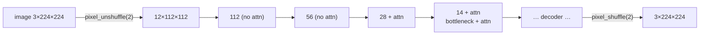

# Going to 224 px

At 224×224 a plain UNet is expensive: there are 12× more pixels than at 64×64, and self-attention cost grows with the square of the number of positions. The 224 preset follows the *Simple Diffusion* recipe (Hoogeboom et al. 2023, *simple diffusion: End-to-end diffusion for high resolution images*).

```bash
python tools/prepare_dataset.py --csv /data/train.csv --image-root /data/images --resolution 224 --out /data/prepared-224.zip
python train.py --config configs/224px_3090.yaml --data /data/prepared-224.zip --outdir runs --cache 0
```

At 224, `prepare_dataset.py` does no resizing but still validates and packs the files.

> **Every value in the preset is untuned.** Run the [throughput probe](training.md#1-size-the-run-throughput-probe) first and expect to iterate.

## The knobs



### Patching

`--patch-size 2` applies `pixel_unshuffle(2)` at the input: each 2×2 block of pixels becomes 4× more channels (3×224×224 → 12×112×112). The final convolution outputs 12 channels, and `pixel_shuffle(2)` rebuilds the image. All internal resolutions are relative to 112. This is the largest compute and memory saving, at a small quality cost. With p = 4, the internal resolution is 56.

### Topology

`--channel-mult 1,2,3,4` gives feature maps 112 → 56 → 28 → 14. The internal resolution (`resolution / patch_size`) must be divisible by 2^(levels−1). Invalid combinations fail immediately with a readable message, e.g.

```
Invalid network topology: Attention resolution(s) [12] do not occur in the UNet; available feature-map resolutions are [64, 32, 16] (resolution 64, patch size 1).
```

### Attention only at low resolution

`--attn-res 28,14`: self-attention runs at 28×28 (784 tokens) and 14×14 (196 tokens), plus the bottleneck, which always has attention. 56×56 would mean 3136 tokens per layer. Attention uses `torch.nn.functional.scaled_dot_product_attention`, which selects the flash or memory-efficient kernels.

### Noise shift

Larger images contain more redundant information, so at a given σ the image is "less destroyed" than a small image. Simple Diffusion shifts the noise schedule toward higher noise for larger images. Here:

```
P_mean_eff = P_mean + ln(resolution / B)          (--noise-shift-base B)
```

This shifts the log-SNR of the training noise distribution by −2·ln(res/B). With B = 64 at 224 px, `P_mean_eff = −1.2 + ln(3.5) ≈ 0.053`.

The sampler's starting noise is scaled to match: `sigma_max = 80 · res / B = 280` (capped by `--sigma-max-cap`, default 1000). Both values are stored in the snapshot and used by `generate.py` unless you pass `--sigma-max`.

Treat B as a hyper-parameter. B = resolution (or 0) disables the shift. Compare runs with the **validation loss per σ** and the grids.

### Gradient checkpointing

`--grad-ckpt 1` wraps every UNet block in `torch.utils.checkpoint` (non-reentrant) during training. Activations are recomputed in the backward pass: much less memory for ~30% more compute. It is usually what allows a useful `--batch-gpu` at 224 px on 24 GB.

### Precision

`--precision bf16` runs the UNet under `torch.autocast(bfloat16)`. The preconditioning, loss and sampler stay in fp32/fp64. Unlike fp16, bf16 needs no loss scaling. `--tf32 1` speeds up any remaining fp32 matmuls.

### Batch

The preset uses `--batch 128 --batch-gpu 32`: 4 accumulation rounds. Use the probe to find the largest `batch_gpu` that fits, and keep `batch` fixed so results stay comparable.

## A suggested order of experiments

1. Get a good 64 px model first: it validates the data, the conditioning and the monitoring cheaply.
2. Run a 224 px probe, then a short run (a few Mimg). Compare grids with the 64 px model upsampled.
3. Vary one knob at a time: noise-shift base (32 / 64 / 112), patch size (2 vs 4), model width.
4. If quality plateaus, see EDM2 in the [next steps](../README.md#roadmap).
