# Conditioning & extensions

## How a condition reaches the network

```mermaid
flowchart LR
    CSV["CSV row<br/>label = 'cat_b'"] --> DS["CSVImageDataset.get_cond<br/>{'class': 1}"]
    DS -->|"default collate"| B["{'class': LongTensor[N]}"]
    B --> L["EDMLoss"] --> P["EDMPrecond.forward<br/>cond_stack.normalize()"]
    P --> U["UNet.forward"]
    U --> CS["ConditionStack<br/>dropout → NULL"]
    CS -->|"sum of encoder outputs"| E["+ noise embedding"]
    E --> M["mapping MLP"] --> R["every residual block<br/>(scale/shift)"]
```



- Conditions are a **dict** `{"class": LongTensor[N], ...}` all the way from the dataset to the UNet.
- `ConditionStack` sums the outputs of its encoders and adds the result to the noise embedding before the mapping MLP (SongUNet; ADM adds it after, as in the original code). Every residual block is therefore modulated through its adaptive scale/shift.
- **Missing keys mean NULL.** `net(x, sigma, {})` or `net(x, sigma, None)` is the unconditional model.
- Backward compatibility: `net(x, sigma, LongTensor)` and EDM-style one-hot float tensors still work.

## The NULL token and label dropout

`ClassEmbedding` is `nn.Embedding(K + 1, dim)`. Index **K** is a **learned NULL token**.

During training (`net.train()`):

- each condition is replaced by NULL with its own probability (`dropout`, from `--label-dropout`);
- additionally, with probability `joint_dropout`, **all** conditions of a sample are dropped together (useful once there are several conditions).

In `eval()` mode nothing is dropped. At sampling time `net.null_cond(n, device)` builds the unconditional input for CFG.

EDM's original code dropped labels by multiplying the one-hot vector by zero, which ties "unconditional" to the bias of a linear layer. A dedicated learned token is cleaner and generalises to non-categorical conditions.

The condition config is a list of dicts. It is stored in the network (`net.cond_config`), in every snapshot (`cond_config`) and in `training_options.json`:

```python
[{"name": "class", "type": "class", "num_classes": 12, "dropout": 0.1}]
```

## Adding a new condition

Example: add a scalar attribute `age` from a CSV column, next to the class.

**1. The encoder.** `training/conditioning.py` already contains a sketch, `ScalarFourierEmbedding`: random Fourier features of the value normalised to [0, 1], then a linear layer. NaN means NULL. For a new type, subclass `ConditionEncoder`:

```python
@persistence.persistent_class
class MyEncoder(ConditionEncoder):
    def __init__(self, name, emb_dim, dropout=0.0, **my_kwargs): ...
    def coerce(self, value, n, device): ...       # user input -> canonical tensor [N, ...]
    def forward(self, value, drop_mask): ...      # -> [N, emb_dim]; use the null embedding where drop_mask
    def null_value(self, n, device): ...          # raw value meaning "unconditional"
    def is_null(self, value): ...

ENCODER_TYPES['my_type'] = MyEncoder
```

A second categorical attribute needs no new code: it is another `ClassEmbedding` with its own name.

**2. The dataset.** In `CSVImageDataset`, read the extra column and return it from `get_cond`:

```python
def get_cond(self, idx):
    cond = {'class': np.int64(self._labels[self._raw_idx[idx]])}
    cond['age'] = np.float32(self._ages[self._raw_idx[idx]])   # NaN for missing values
    return cond
```

`prepare_dataset.py` would also need to carry the column into `dataset.json` (`rows`).

**3. The config.** In `train.py`, append to `cond_config`:

```python
cond_config.append(dict(name='age', type='scalar', min=0, max=100, dropout=0.1))
```

The planned user-facing form is a flag such as `--cond-cols age:scalar,site:class`.

**4. Sampling.** Pass the value in the cond dict (`{'class': ..., 'age': ...}`). With CFG, `null_cond` drops **all** conditions, so guidance applies to the joint condition. For per-condition guidance, build a partially-null dict yourself and call `training.sampling.guided_denoise`.

**5. Validation and grids.** `compute_val_loss` and the training grids use the condition dicts as they are. Grids are organised by class, and other conditions are NULL in grids unless you extend `save_sample_grid`.

## Design notes

- Encoders output `emb_dim` = the noise-embedding width at the injection point, so conditions add and never concatenate. New conditions do not change the shapes of other layers, which makes them cheap to add, though not to existing checkpoints: a new encoder starts untrained.
- `ConditionStack.normalize()` is the single place where user input is canonicalised (dtype, device, broadcasting a scalar to the batch, filling missing keys with NULL).
