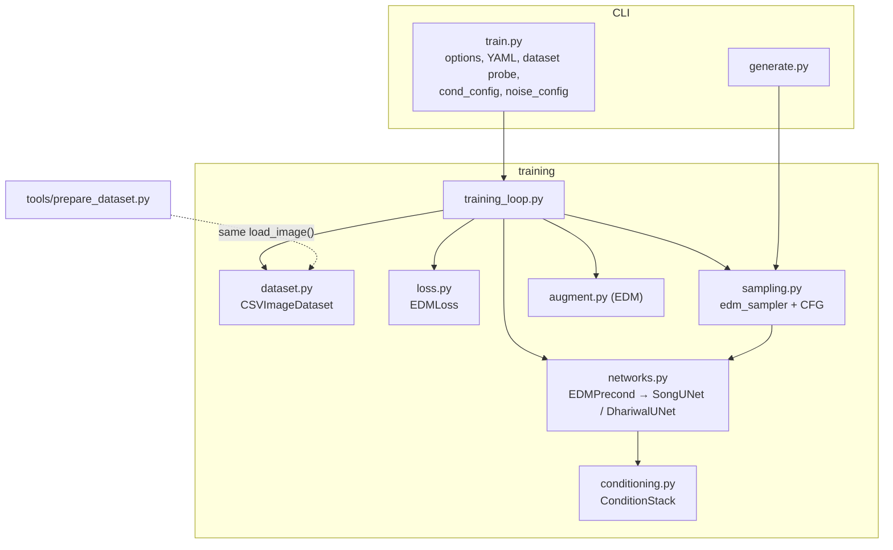

# How it works

## EDM in one page

Training data `y` is scaled to [−1, 1] (σ_data = 0.5). The network learns a **denoiser** D(x; σ) from noisy images x = y + n, with n ~ N(0, σ²I).

**Preconditioning** (`training/networks.py: EDMPrecond`) wraps the raw UNet F:

```
D(x; σ) = c_skip(σ) · x + c_out(σ) · F( c_in(σ) · x ; c_noise(σ), cond )

c_skip = σ_d² / (σ² + σ_d²)      c_out = σ · σ_d / sqrt(σ² + σ_d²)
c_in   = 1 / sqrt(σ² + σ_d²)     c_noise = ln(σ) / 4
```

**Loss** (`training/loss.py: EDMLoss`):

```
ln σ ~ N(P_mean_eff, P_std²)                   P_mean_eff = P_mean (+ ln(res/B) with the noise shift)
λ(σ) = (σ² + σ_d²) / (σ · σ_d)²
L    = E[ λ(σ) · ‖D(y + n; σ, cond) − y‖² ]
```

λ makes the loss ≈ O(1) at every σ, so losses at different noise levels are comparable. The [per-σ curves](monitoring.md) rely on this.

**Sampling** (`training/sampling.py: edm_sampler`) integrates the probability-flow ODE `dx/dσ = (x − D(x; σ)) / σ` from σ_max down to 0 with Heun's method. The step σ_i follows `(σ_max^(1/ρ) + i/(N−1)·(σ_min^(1/ρ) − σ_max^(1/ρ)))^ρ` with ρ = 7.

**Classifier-free guidance** replaces D by `D_u + w·(D_c − D_u)` (`guided_denoise`), optionally only for σ in an interval.

## Code map



| File | Role |
|---|---|
| `train.py` | CLI. Merges the YAML preset with the flags, builds the dataset once to get the resolution, number of classes and label map, assembles `network_kwargs` / `loss_kwargs` / `noise_config`, picks the run directory. |
| `training/training_loop.py` | Data stream (`ResumableInfiniteSampler`), gradient accumulation, lr schedule, EMAs, per-σ statistics, validation loss, grids, snapshots, states, retention, graceful stop. |
| `training/dataset.py` | `CSVImageDataset` (raw CSV or prepared zip/dir), `load_image()` (shared with `prepare_dataset.py`), label map helpers, stratified split. The original EDM `ImageFolderDataset` is kept for `fid.py`. |
| `training/networks.py` | EDM's UNets with: dict conditioning, topology validation, pixel (un)shuffle, SDPA attention, gradient checkpointing. `EDMPrecond` with autocast precision. (VP/VE/iDDPM preconditioners are kept but unused.) |
| `training/conditioning.py` | Condition encoders and the stack. |
| `training/loss.py` | `EDMLoss` + noise shift + σ bins. |
| `training/sampling.py` | Heun sampler with CFG / guidance interval, per-seed RNG, grids. |
| `torch_utils/` | EDM utilities. `distributed.py` was reworked (no torchrun needed, Gloo/NCCL, SIGINT/SIGTERM). `misc.py` gained the resumable sampler. |
| `dnnlib/` | EDM utilities (unchanged). |

## Training step

For each of the `batch / batch_gpu` accumulation rounds:

1. take `batch_gpu` uint8 images + cond dict from the stream and scale them to [−1, 1];
2. `EDMLoss`: draw σ, add noise, optional augmentation, run `D` (label dropout happens inside `ConditionStack`), compute the λ-weighted error;
3. record per-image losses into the 8 σ bins (accumulated on the device, no host sync);
4. backward with the loss scaled by `1 / batch`.

Then: set the lr (ramp-up and optional inv-sqrt decay), zero NaN/Inf gradients, optionally clip, step Adam, update every EMA with `β = 0.5^(batch / half_life)` (half-life ramped up to 5% of the images seen so far).

Once per tick: status line, validation, grids, snapshot, state, retention and logs, depending on the periods.

## File contents

**Network snapshot** `network-snapshot-<kimg>.pkl` (pickle, code embedded via `torch_utils.persistence`):

| Key | Content |
|---|---|
| `ema` | primary EMA network (`EDMPrecond`, eval mode, CPU) |
| `emas` | `{half_life_kimg (str): network}` for every EMA |
| `label_map` | same content as `labels.json` |
| `cond_config` | condition config list |
| `noise_config` | `P_mean`, `P_std`, `P_mean_eff`, `noise_shift_base`, `sigma_max` (sampler hint), `resolution`, `patch_size` |
| `loss_fn`, `augment_pipe` | as in EDM |
| `dataset_kwargs`, `training_options` | how the run was configured |
| `kimg` | progress at save time |

**Training state** `training-state-<kimg>.pt` (`torch.save`, loaded with `weights_only=False`): `net`, `optimizer_state`, `emas` (state dicts), `cur_nimg`, `cur_tick`, `seed`, `rng` (torch / numpy / CUDA states), `label_map`, `cond_config`.

Both files are written to a temporary name and then renamed, so an interrupted save never leaves a truncated file.

## Differences from upstream EDM

| Area | Upstream EDM | Here |
|---|---|---|
| Data | ImageFolder zip with `dataset.json` labels | CSV + root, or prepared zip/dir; string labels; split |
| Conditioning | one-hot × Linear, zero-vector dropout | modular encoders, learned NULL token |
| Precision | manual fp16 casts | autocast fp32 / fp16 / **bf16**, TF32 on |
| Attention | custom `AttentionOp` | PyTorch SDPA (same weight layout) |
| Large images | – | patching, configurable attention resolutions, grad checkpointing, noise shift |
| Launch | torchrun + NCCL required | plain `python`, CPU support |
| Monitoring | loss + FID | per-σ loss, fixed-σ validation loss, grids, memorization check |
| Resume | network + optimizer only, kimg from the filename | everything incl. EMAs, RNG, data position |
| Sampling | random/one class, no CFG | class names, per-class, CFG + interval, metadata |
