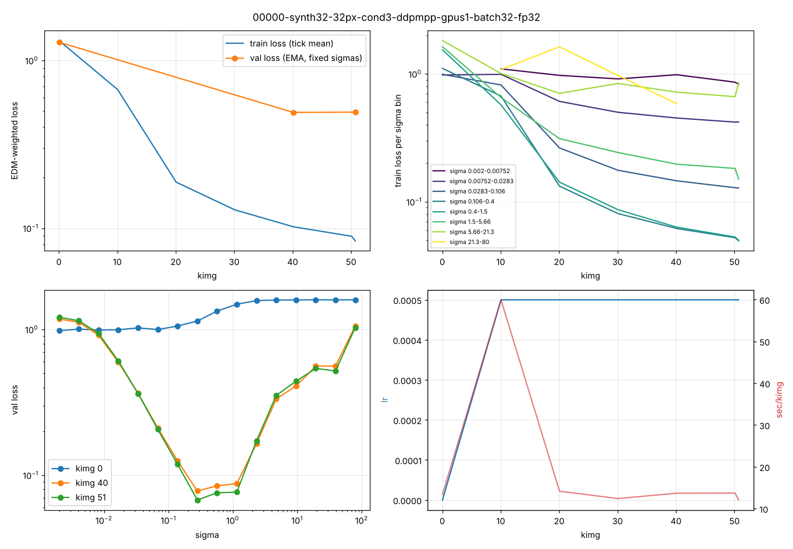
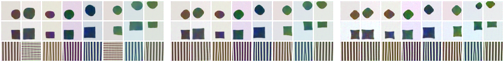
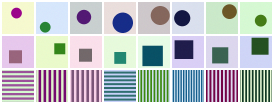

# Monitoring

No pretrained network is available for the target data, so monitoring relies on three things that need none: the **validation denoising loss** at fixed noise levels, **sample grids** with fixed seeds, and an optional **pixel-space memorization check**.

## Run directory

```
runs/00003-prepared-64-64px-cond12-ddpmpp-gpus1-batch256-bf16/
├── training_options.json          fully resolved configuration
├── labels.json                    label map + training class counts
├── log.txt                        everything printed (one status line per tick)
├── stats.jsonl                    all scalars, one JSON line per tick
├── reals.png                      real images: one row per class
├── samples-000000.png …           generated grids (fixed seeds), one block per guidance value
├── network-snapshot-002000.pkl …  EMA network(s) + label map + noise config (for generate.py)
└── training-state-002000.pt …     full state for --resume
```

## Status line

```
tick 41  kimg 2050.0  time 3h 22m  sec/tick 295.1  sec/kimg 5.90  maintenance 0.4  loss 0.3120  lr 2.00e-04  cpumem 3.10  gpumem 17.31  reserved 18.02  val 0.3391 (6.2s)
```

`loss` is the mean training loss over the tick. `val` appears on validation ticks only. `gpumem`/`reserved` are peak values since the previous tick.

## Scalars in `stats.jsonl`

Each line is `{"<name>": {"num": n, "mean": m, "std": s}, ..., "timestamp": t}`. Only scalars reported during that tick are included.

| Name | Meaning |
|---|---|
| `Loss/loss` | EDM-weighted training loss (per image), mean over the tick |
| `Loss/sigma_bin_0` … `_7` | training loss in 8 **fixed** log-σ bins spanning [0.002, 80] (bin edges: `training/loss.py: SIGMA_BIN_EDGES`) |
| `Val/loss` | validation loss of the primary EMA, averaged over 16 fixed σ |
| `Val/loss_sigma_00` … `_15` | validation loss at σ = 0.002 … 80 (log-spaced; `training/training_loop.py: VAL_SIGMAS`) |
| `Loss/grad_norm` | only with `--grad-clip` |
| `Progress/kimg`, `Progress/tick`, `Progress/lr` | progress |
| `Timing/*`, `Resources/*` | speed and memory |

The **validation loss** uses a fixed subset of up to `--val-max` (1024) validation images, fixed σ values and **fixed noise seeds**. It is therefore directly comparable **across ticks and across runs** on the same data, and it is the primary model-selection metric.

Reading it from Python:

```python
import json
rows = [json.loads(l) for l in open('runs/<run>/stats.jsonl')]
val = [(r['Progress/kimg']['mean'], r['Val/loss']['mean']) for r in rows if 'Val/loss' in r]
```

## Plots

```bash
python tools/plot_stats.py runs/<run>     # → runs/<run>/stats.png
```



The four panels show:

1. training and validation loss vs kimg;
2. training loss per σ bin vs kimg;
3. validation loss as a function of σ, at the first, middle and latest evaluation;
4. learning rate and sec/kimg.

## How to read them

| Observation | Interpretation / action |
|---|---|
| Validation loss decreasing, then flat | Normal. Pick the snapshot near the start of the plateau, or keep going while grids improve. |
| Validation loss rising while training loss keeps falling | **Overfitting**. Enable `--augment 0.12`, use a smaller model or more dropout, stop earlier, and check the memorization report. |
| Low-σ bins (0.002–0.03) improve last | Normal: fine texture is learned last. |
| High-σ bins (> 20) stay high and flat | Normal: the global layout is barely predictable from almost pure noise. |
| Sudden spike in every curve | Instability: lower `--lr`, add `--grad-clip 1`, make sure `--precision` is bf16 rather than fp16. |
| The val-vs-σ curve keeps improving in its middle part (σ ≈ 0.1–2) | This is where most perceptual quality comes from. |

## Sample grids

`samples-<kimg>.png` holds one row per class (the first `--sample-max-classes`, default 16, in label-index order), `--sample-cols` fixed seeds per row (default 8), and one block per guidance value (`--sample-guidance`, default `1,2,4`, left to right). It is sampled with the primary EMA and `--sample-steps` (32) Heun steps. The seeds never change, so the same cell can be compared across snapshots. `reals.png` has the same layout with real images.

Training grid of the CPU smoke test at 40 kimg (guidance 1 | 2 | 4), compared with the reals:





What to check:

- Is each row recognisably its class? If guidance 1 already works, conditioning is strong.
- Is there diversity along each row? If guidance 4 collapses everything to one mode or saturates the colours, guidance is too high.
- Do the grids keep improving between snapshots, or has quality plateaued?

## Memorization check (optional)

This check finds each generated image's nearest training image in **pixel space** (L2 distance after resizing to `--resolution`, default 64). No pretrained features are involved.

```bash
python generate.py --network runs/<run>/network-snapshot-XXXXXX.pkl --outdir gen-check --per-class 32 --guidance 2
python tools/memorization_check.py --gen gen-check --data /data/prepared-64.zip --resolution 64 --outdir memcheck
```

Outputs in `memcheck/`:

- `pair-NNN-rmsX.png`: generated image | nearest training image, for the closest pairs;
- `nearest.csv`: the nearest neighbour of every sample;
- `summary.json`: the fraction of samples with RMS distance (in [0,1] pixel units) below `--threshold` (default 0.05), plus the minimum and median distance.

Near-duplicates of training images show up as very small distances. Look at the pairs: pixel L2 does not detect shifted or recoloured copies. Use `--max-train` to subsample very large training sets.

## TensorBoard

```bash
uv sync --extra cu126 --extra tensorboard
python train.py ... --tensorboard 1
tensorboard --logdir runs
```

The same scalars are logged with kimg as the step.

## FID (optional, not recommended here)

`fid.py` is EDM's FID script. It downloads a **pretrained Inception-v3** network, so it is not part of the training path, and its features are not meaningful for data far from ImageNet. It is kept only for reference. A domain classifier trained from scratch is listed as a possible next step.
