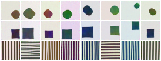

# Sampling

`generate.py` loads a network snapshot. The snapshot contains the EMA network, the **label map** and the **noise configuration**, so nothing else is needed: no CSV, no `labels.json`.

```bash
SNAP=runs/<run>/network-snapshot-XXXXXX.pkl
```

## Choosing what to generate

| Goal | Command |
|---|---|
| N images **per class** (all classes) | `python generate.py --network $SNAP --outdir out --per-class 16 --guidance 2 --grid 1` |
| Specific classes **by name** | `python generate.py --network $SNAP --outdir out --class cat_a,cat_b --seeds 0-63 --guidance 2` |
| A class by index | `... --class-idx 3 --seeds 0-63` |
| N per class for selected classes | `... --class cat_a,cat_b --per-class 8` |
| Random classes, uniform | `... --seeds 0-999` (default `--class-dist uniform`) |
| Random classes, training frequencies | `... --seeds 0-999 --class-dist data` |

Rules:

- `--seeds` takes a list or ranges (`0-63`, `1,5,9-12`). The default is `0-63`.
- With `--per-class N`, each class uses seeds `0..N-1`, or the first N of `--seeds` if given.
- With random classes, each seed's class is drawn from a generator seeded by that seed, so it is reproducible.

## Classifier-free guidance

`--guidance w` (default 1):

```
D = D_uncond + w · (D_cond − D_uncond)
```

| w | Meaning |
|---|---|
| 0 | unconditional model (NULL label) |
| 1 | plain conditional model, **no CFG** (only one forward pass) |
| 1.5–3 | typical range: stronger class adherence, less diversity |
| > 4 | usually over-saturated, low diversity |

The conditional and unconditional passes are computed in **one** forward pass by concatenating the two batches.

To compare guidance strengths:

```bash
for w in 1 1.5 2 3 4; do
  python generate.py --network $SNAP --outdir out/g$w --per-class 8 --guidance $w --grid 1
done
```

### Guidance interval

`--guidance-interval SMIN,SMAX` applies CFG only while σ ∈ [SMIN, SMAX] and uses w = 1 elsewhere (Kynkäänniemi et al. 2024, *Applying guidance in a limited interval*). Restricting CFG to the middle noise levels often keeps diversity (high σ) and avoids over-sharpening (low σ):

```bash
python generate.py --network $SNAP --outdir out/gi --per-class 8 --guidance 3 --guidance-interval 0.3,5
```

This is untuned for your data; scan a few intervals with the grids.

## Sampler options

The sampler is EDM's 2nd-order Heun sampler (Algorithm 2 of the EDM paper):

| Option | Default | Notes |
|---|---|---|
| `--steps` | 32 | Heun steps (2·steps−1 network evaluations; doubled batch with CFG). 18–40 is typical. |
| `--sigma-max` | snapshot hint | 80, or 80·res/B with the [noise shift](224px.md#noise-shift). |
| `--sigma-min` | 0.002 | |
| `--rho` | 7 | Step spacing. |
| `--S-churn`, `--S-min`, `--S-max`, `--S-noise` | 0, 0, ∞, 1 | Stochastic sampling. 0 = deterministic ODE. |
| `--ema-halflife MIMG` | primary | Use another EMA saved with `--ema-list`. |
| `--batch` | 64 | Images per forward pass (×2 with CFG). |
| `--device cuda\|cpu` | auto | |

## Outputs

```
out/
├── cat_a/000000.png, 000001.png, …    one folder per label (label sanitised for the file system)
├── cat_b/…
├── metadata.csv                       file,label,label_idx,seed,guidance
└── grid.png                           with --grid 1: rows = classes, columns = that class's images
```

Generation from the smoke-test model (50 kimg on CPU, `--per-class 8 --guidance 2 --grid 1`):



## Determinism

The same snapshot, seed, class, guidance, sampler options **and batch composition** give a bit-identical image. With a different `--batch` (or different neighbours in the batch), float round-off differs by ~1e-6, which can flip a pixel by one uint8 level at most. GPU results can also differ slightly from CPU results.

## Multi-GPU

```bash
torchrun --standalone --nproc_per_node=2 generate.py --network $SNAP --outdir out --per-class 64 --guidance 2
```

Each rank writes `metadata-rank<R>.csv` (and `grid-rank<R>.png`). Not tested.

## Using a snapshot from Python

```python
import pickle, torch
from training.sampling import generate

with open(SNAP, 'rb') as f:
    snap = pickle.load(f)
net = snap['ema'].eval().cuda()
label_to_idx = snap['label_map']['label_to_idx']

idx = label_to_idx['cat_a']
images = generate(net, seeds=list(range(16)), class_indices=[idx] * 16, device='cuda',
                  guidance=2.0, num_steps=32, sigma_max=snap['noise_config']['sigma_max'])
# images: uint8 tensor [16, 3, H, W]
```

The code is pickled with the snapshot (EDM's `persistence`), so snapshots remain loadable after the source is edited, as long as the repository is on the Python path.
