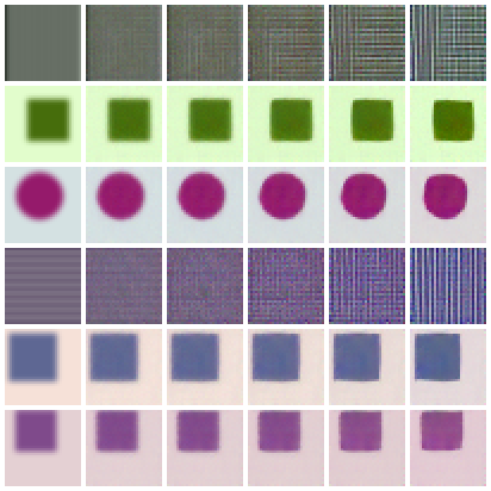
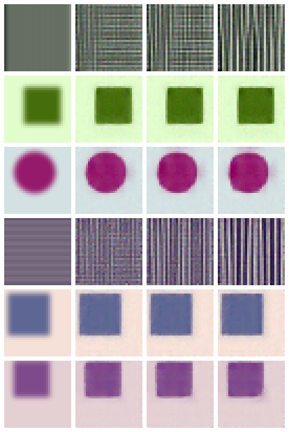
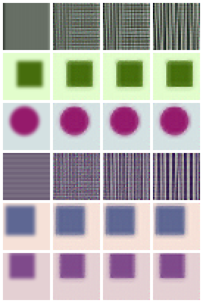
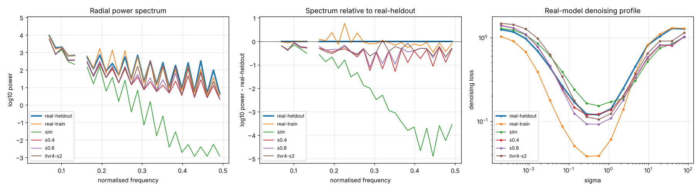

# Sim-to-real style transfer

Use a model trained on **real** images to make **simulated** images look real at the level of **blur, grain, sensor noise and fine texture**, while keeping the **scene and the class**. Nothing new has to be trained: the tool works on any network snapshot.

```bash
# 1. Sweep the starting noise level on a few images (unconditional)
python tools/translate.py --network runs/<run>/network-snapshot-XXXXXX.pkl \
    --csv /data/sim.csv --image-root /data/sim --sigma-start 0.05,0.1,0.2,0.4,0.8 \
    --max-images 64 --outdir sweep

# 2. Measure the gap to HELD-OUT real images for each setting
python tools/domain_gap.py --network runs/<run>/network-snapshot-XXXXXX.pkl \
    --set real=/data/real-holdout.csv@/data/images --set sim=/data/sim.csv@/data/sim \
    --set s0.1=sweep/sigma-0.1 --set s0.2=sweep/sigma-0.2 --set s0.4=sweep/sigma-0.4 --outdir gap

# 3. Translate everything with the chosen setting (add ILVR to lock the scene)
python tools/translate.py --network runs/<run>/network-snapshot-XXXXXX.pkl \
    --csv /data/sim.csv --image-root /data/sim --sigma-start 0.4 --ilvr-factor 8 --outdir sim2real
```

## When it is the right tool

| The gap between sim and real is… | Use this? |
|---|---|
| **small and in high frequencies**: blur / PSF, grain, sensor noise, fine texture, compression | **yes**: this is the intended case |
| in low frequencies: global colour, contrast, illumination | partially. It needs a high σ₀, which endangers the scene. Fix it first with histogram matching or Fourier domain adaptation, then translate. |
| geometric or semantic: shapes, objects that differ | no. Translation cannot fix content without changing it. Improve the simulator. |

> **Information that is missing in the simulated image cannot be recovered.** It can only be *invented*. In the demo below, stripes erased by the simulated blur come back as plausible but *wrong* stripes.

## How it works

The model knows the real distribution at every noise level σ. Noise erases detail from the finest scale upward: at noise level σ, the simulated and the real versions of an image differ less and less. The model then denoises "the real way".

**SDEdit** (Meng et al. 2021, *SDEdit: Guided Image Synthesis and Editing with Stochastic Differential Equations*):

```
x = x_sim + σ₀ · ε,  ε ~ N(0, I)        then the EDM Heun sampler from σ₀ down to 0 (--steps steps)
```

Detail finer than the scale of σ₀ is regenerated; coarser structure is kept. In [-1, 1] pixel units (σ_data = 0.5):

| σ₀ | regenerated | kept |
|---|---|---|
| ~0.05 | grain, sensor noise | essentially everything else |
| ~0.1–0.4 | fine texture, edge sharpness | scene, shapes, colours |
| ~1–2 | mid-scale detail | coarse layout only |
| ≥ 5 | almost everything | this is generation, not translation |

**ILVR** (Choi et al. 2021, *ILVR: Conditioning Method for Denoising Diffusion Probabilistic Models*) adds a hard constraint after every step:

```
x ← x − LP_N(x) + LP_N(x_sim + σ · ε')         LP_N = average-pool by N, bilinear upsample
```

Frequencies below ~1/N of the image size are forced to follow the simulated image, so the **scene is locked even at larger σ₀**, and only finer detail is generated. The last step is left free to avoid filter artefacts. `--ilvr-sigma-min` stops the constraint earlier.

The key point when choosing N: ILVR re-imposes **everything** below its cut-off, including the simulator's blur. N must be large enough that the frequencies where sim and real differ lie *above* the cut-off:

- **larger N**: the constraint only covers coarse structure, so the model is free to change edges and texture;
- **smaller N**: closer to the input, including its blur.

At 224 px, try N ∈ {4, 8, 16}.

The sampler is stochastic: `--samples-per-image K` gives K different realisations per input (seed of image i, variant k = `seed + i·K + k`, reproducible).

## Conditioning: unconditional by default

Without `--label-col`, translation uses the NULL label, i.e. the model's unconditional mode. This is the default because:

- the class of the input does not need to be known;
- classes that are weak or collapsed in the conditional model cannot take over;
- at the low σ₀ used for translation, the class matters little anyway: the input image already fixes it.

With `--label-col` (CSV labels, same names as in training), translation is conditioned on each image's class. `--guidance w > 1` adds CFG, but CFG strengthens class stereotypes, which is the opposite of what you want for translation. Keep w ≤ 1.5, or stay unconditional.

## Choosing the settings

1. Run `translate.py` on 32–64 images with a σ₀ sweep, e.g. `0.05,0.1,0.2,0.4,0.8`. Look at `compare.png` (input | σ₁ | σ₂ | …) and find the largest σ₀ where the scene and class are still right.
2. Run `domain_gap.py` against **held-out real images** (not the training images: see below). Prefer the setting where grain, sharpness and high-frequency energy are closest to 1.0 relative to real, and the denoising-profile gap is lowest.
3. If the scene drifts before the texture looks real, add ILVR (`--ilvr-factor 8` at 224 px) and push σ₀ higher.
4. Only the **downstream task** can confirm the choice: train your task model on translated sim images and evaluate it on real data.

`--steps` (default 16) are Heun steps over [σ₀, 0], i.e. 2·steps−1 network evaluations per image. Low σ₀ needs fewer steps than generation; 8–16 is usually enough. Check that results stop changing when you double it.

## Measuring the gap: `domain_gap.py`

None of these metrics uses a pretrained feature extractor.

| Metric | What it captures | Target |
|---|---|---|
| `hf_energy_ratio_vs_ref` | power above normalised frequency 0.25 (luminance, radial spectrum) | 1.0 |
| `grain_ratio_vs_ref` | noise std estimate (Immerkaer's method) | 1.0 |
| `sharpness_ratio_vs_ref` | mean gradient magnitude | 1.0 |
| `spectrum_log_gap_vs_ref` | mean \|Δ log10 power\| over all frequencies | 0 |
| `denoise_profile_log_gap_vs_ref` | how differently the **real-data model** denoises the set, across 16 σ (with `--network`) | 0 |

`domain_gap.png` shows the spectra, the spectra relative to the reference, and the denoising profiles. `report.json` has every number.

Caveats:

- **The reference must be held-out real images.** On its own training images a model has a markedly lower denoising loss (in the demo, the training images were further from held-out reals than the simulated images were).
- Compare sets with the **same content mix** (same classes, similar scenes). Grain and sharpness estimators react to edges and textures, not only to noise.
- Low resolution hides grain. Analyse at the resolution you will use.

## Training a model for translation

Translation uses the **low-σ** part of the model, and the unconditional (NULL) mode. Two training choices matter:

- **Noise shift.** The 224 preset uses `--noise-shift-base 64`, which moves training toward *high* σ (good for generation). Fewer training samples then fall in the σ range used by translation: P(σ < 0.1) drops from ~18% (EDM default) to ~2.5%. If translation is the main use, train with `--noise-shift-base 0`, or compare `Val/loss_sigma_00…06` (σ ≤ 0.14) between runs.
- **Label dropout.** The NULL token is only trained on `--label-dropout` of the samples (10% by default). For mostly unconditional use, `--label-dropout 0.2–0.3` strengthens it at little cost to conditional generation. An unconditional model (`--uncond 1`) is also fine for translation.

The translation resolution is the model's resolution. Inputs are resized to it with the same filter as training.

## Demo (synthetic data, CPU)

"Real" images: synthetic shapes with grain (`make_synthetic_dataset.py`, the training set of the 32 px [smoke-test](smoke-test/README.md) model). "Simulated" images: other scenes of the same classes, **no grain, strong blur** (`--noise-std 0 --blur 8`). The model is a tiny 32 px network trained for 20 minutes on CPU, so the images are small and the model is weak. The behaviour is still representative.

**SDEdit sweep.** Columns: input | σ₀ = 0.05 | 0.1 | 0.2 | 0.4 | 0.8.



Edges sharpen progressively, and scene and colour are kept. Rows 1 and 4 show the limit: the stripes were erased by the simulated blur, so the model invents stripes, and at σ₀ = 0.8 one orientation flips.

**ILVR.** Columns: input | σ₀ = 0.4 | 0.8 | 2. Factor 4 on the left, factor 2 on the right.

<p>
  &nbsp;&nbsp;
  
</p>

The scene is locked even at σ₀ = 2. With N = 4 the edges become sharp like the real images; with N = 2 they stay soft, because the simulator's blur lies below the cut-off and is re-imposed.

**Measured gap** (relative to held-out real images; disks and squares only for grain and sharpness):

| Set | HF energy | grain | sharpness | denoising-profile gap |
|---|---|---|---|---|
| sim | 0.006 | 0.06 | 0.95 | 0.27 |
| SDEdit σ₀ = 0.4 | 0.34 | 0.75 | 0.99 | **0.16** |
| SDEdit σ₀ = 0.8 | 0.42 | 0.74 | 1.00 | 0.22 |
| ILVR N = 4, σ₀ = 2 | 0.43 | 0.80 | 1.09 | 0.20 |

The denoising-profile gap is measured on all classes.



## Limitations and alternatives

- It cannot recover information the simulator did not produce. It invents plausible detail, which can be wrong.
- Too high a σ₀, or no ILVR, can change content without warning. Check `compare.png` and the class of the outputs.
- Each image costs 2·steps−1 network evaluations. For millions of images, distilling the result into a feed-forward network (e.g. CUT/CycleGAN trained on sim → translated pairs) is an option.
- If SDEdit/ILVR is not enough:
  - **DDIB** (Su et al. 2022) gives deterministic, cycle-consistent translation. It needs a model that also knows the simulated domain: add a `domain` condition (see [conditioning](conditioning.md)) and train on sim + real.
  - **Structure-conditioned diffusion** trains `p(real | structure)` on real images only. It needs spatial conditioning, which is not implemented yet.
